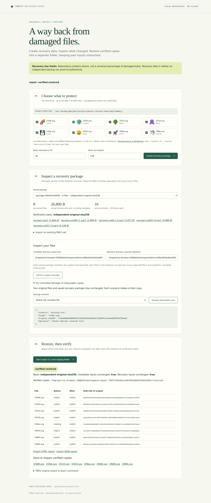

# Parity Recovery Desk

A local browser workbench for creating PAR2 recovery packages, inspecting file
damage, and restoring verified copies without modifying source or recovery
inputs. It uses the established **par2cmdline 0.8.1** engine, with independent
SHA-256 and byte comparisons for packages created here.



## Launch

```sh
./launch.sh
```

Open **http://127.0.0.1:8765**. The first launch downloads a checksum-pinned
upstream PAR2 source archive and builds it locally in `.tools/`; later launches
work offline. Requires Python **3.12+**, a POSIX system, `g++` and `make`.
No root, Python packages, cloud account or paid services are needed. Tested on
Linux x86-64. macOS is a target but has not been tested; native Windows is not
supported (a Linux environment such as WSL may work, untested).

To use your own files, launch with a **flat directory**:

```sh
./launch.sh --source /absolute/path/to/files
```

Choose a subset with the checkboxes, set block size and redundancy, then click
**Create recovery package**. Every selected file must be supported; errors abort
the package rather than silently dropping members. Download all listed PAR2
files and retain them somewhere independent of the vulnerable storage device.
The UI reports their actual byte sizes, including metadata overhead.

To inspect later damage, select the saved package and enter the current
candidate directory. Click **Verify & inspect damage**. To restore, click
**Start repair in a new staging folder**. It always creates a new directory;
there is no in-place repair or caller-specified output destination to overwrite.
Only fully verified batches receive a `restored/` directory and download links.
Download those files, or copy them from the displayed output directory, and
reopen them with the appropriate application. Failure/cancellation leaves only
unverified staging artifacts, never downloadable restored copies.

## Try the included real-file workflow

The default source is eight unmodified [Twemoji SVG graphics](data/sources.json),
by Twitter and contributors, licensed [CC BY 4.0](data/LICENSE-GRAPHICS).
The pinned revision is `7a3dad4a4da30497093dab22eafba135f02308e1` (v14.0.2).
Original source URLs, SHA-256, sizes and attribution are recorded per file.
`python3 scripts/acquire.py` reacquires the exact bytes and rejects hash changes.

1. Keep all eight selected and use 30% redundancy / 256-byte blocks. Create.
2. Verify the default source: every file should match.
3. Prepare a **Delete the smallest file** disposable case. Verify: repair possible.
4. Explicitly start repair. Save/reopen the eight verified SVG copies. Export
   the standalone HTML and JSON reports.
5. Prepare **Insufficient** or **destroy recovery volumes**, then repair. These
   cases must say `insufficient-recovery`, with no restored-file links.

The disposable-case controls never alter your source or saved package. The UI
shows exact mutation details. Predictions are for this documented subset/settings,
not arbitrary selections. The [evaluation protocol](docs/evaluation-protocol.md)
and [observed results](results/evaluation.json) retain both successes and failures.
A [portable sample HTML report](results/sample-report.html) and
[JSON report](results/sample-report.json) can be opened without the server.
Sample report paths are historical temporary directories, not live downloads.

## Import and verification meaning

The import panel accepts an absolute local directory of `.par2` files. It
validates PAR2 packet checksums and supported metadata, then copies recovery
inputs into the workspace. Only a bounded flat ASCII-name subset of PAR2 is
supported. Unsafe paths, case collisions, non-recovery members, empty members,
Unicode alternate names, unknown packet types and mixed recovery sets are
rejected. This is not a universal PAR2 client.

* **independent-original-sha256**: every restored file must match both the
  original recorded SHA-256/size and the preserved original bytes. The engine's
  exit code alone cannot establish success.
* **imported-par2-md5-only**: every output must match the imported PAR2 file
  description's MD5 and size, plus successful PAR2 verification. SHA-256 values
  are recorded for the output, but there is **no independent original SHA-256
  baseline**. Imported success is explicitly weaker and does not prove authenticity.

The app keeps original snapshots for independently checked packages in
`.runtime/package-*/originals`; they are **never supplied to the repair engine**.
Real damaged candidates and recovery copies alone enter its isolated staging
folder. Only the filenames listed in the package are copied from a candidate
directory. Extra candidate files are ignored; all expected files are reported.
Your candidate and recovery inputs are rehashed after each operation.

## Limits and operating model

* 1–64 selected files, each nonempty and at most 4 MiB; at most 16 MiB of data.
  Candidate copies also have a 16 MiB cap. Up to 32 PAR2 files / 48 MiB total.
* Names: 1–120 ASCII letters/digits, spaces, `_ . + -`, starting with a letter
  or digit; no trailing dot/space, reserved Windows names or `.par2` data names.
  No subdirectories, symlinks, hardlinks, special files or duplicate/case-colliding
  selections. Unsupported directory entries remain visible with reasons.
* Blocks: multiples of 4, 64 bytes–1 MiB; no more than 8192 data/recovery blocks;
  redundancy 1–100%. One changed byte can invalidate a whole block. Scattered
  corruption can exhaust recovery at a much smaller byte fraction than the
  chosen redundancy. Recovery files themselves can be damaged.
* One operation at a time. PAR2 is capped at 120 seconds elapsed / CPU,
  1 GiB address space, 64 MiB per output file, 128 open descriptors, two threads,
  and a 64 MiB engine memory option. Captured engine output is limited to 1 MiB.
  Cancellation kills the process group; an accepted cancellation before the atomic
  publication boundary prevents publication. A cancellation arriving after that
  boundary is explicitly reported as too late, and the committed output is retained.
* New operations are refused once the workspace already holds 384 MiB. A bounded
  operation can temporarily add up to roughly 128 MiB. Archive old results and
  remove their `.runtime/` directories when the server is stopped. Originals,
  parity, unverified stages and reports use disk space; this is deliberately a
  small-file workbench, not a full disk rescue tool.
* Inputs are read with no-follow checks, regular-file checks and before/after
  identity/size/mtime/ctime checks, then rehashed around execution. Concurrent
  editing is rejected when detected. Keep sources stable while an operation runs.
* Loopback only, same-origin checks, a per-process request token, no CORS and
  no external runtime assets. Use the printed `127.0.0.1` URL. This is a trusted
  single-user local app, not a network service or sandbox against another local
  process modifying the workspace. Do not expose its port publicly.
* Saved packages persist and are listed after restart. Reports remain on disk;
  the UI displays the latest operation during the session. There is no migration
  or crash-resume protocol; incomplete jobs remain unverified.
* Recovery data is **neither an independent backup nor proof of authenticity**.
  Store real backups separately. A package on a failed disk cannot protect that
  disk, and PAR2 metadata can be replaced by an attacker.

## Reproduce validation

```sh
python3 scripts/bootstrap.py
python3 -m unittest discover -s tests -p 'test_*.py' -v
python3 scripts/evaluate.py
npm ci
npx playwright install chromium
node tests/browser.mjs
python3 scripts/check_tree.py
```

Node 20+ and Playwright are development-only dependencies. In restricted
containers, set `PLAYWRIGHT_BROWSERS_PATH` to a writable directory when installing
and running, or `CHROMIUM_PATH` to an existing headless Chromium executable.
No browser download is needed to use the application. Browser evidence records
Chromium only; Firefox, Safari and native macOS are unverified.

The browser exercise creates a real package, verifies, reloads, stages a missing
file, inspects, explicitly repairs, downloads every restoration, independently
compares bytes/hashes, reopens each SVG, exports/reopens reports, checks both
failure scenarios, imports a set and checks a narrow viewport. Security/resource
negative controls are labeled separately in the tests. See
[primary references and existing applications](docs/references.md); no novel
recovery algorithm is claimed.
