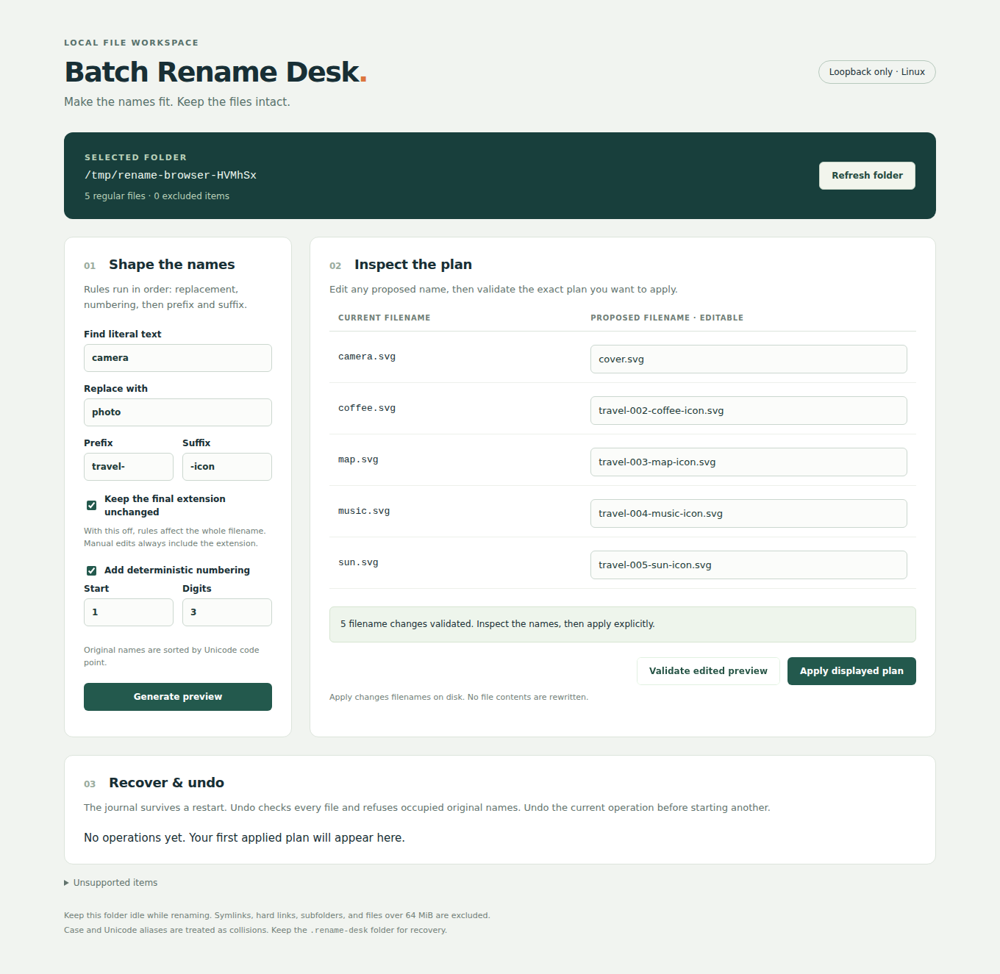

# Batch Rename Desk

Inspect a batch of filenames, edit the plan, apply it explicitly, and restore the original names from a durable local journal. The browser controls a Python process on your own machine; files are never uploaded.

## Launch

Requires **Linux, Python 3.10+, glibc with `renameat2`, and a local case-sensitive filesystem supporting `RENAME_NOREPLACE` and directory `fsync`**. No Python dependencies are needed. Chromium is the browser tested here.

```sh
python3 app.py --open
```

This creates a **new disposable copy** of five real MIT-licensed Feather SVGs in your temporary directory and opens the local browser. If browser opening is unavailable, copy the printed URL, including its fragment. This demo works offline; the originals in `demo/source` remain untouched. Keep the printed folder path to resume the same demo after stopping the server.

For a folder of your own (back up valuable data first):

```sh
python3 app.py --folder /absolute/path/to/folder --open
```

The folder is selected at launch, not through a browser filesystem picker. Only that directory's eligible regular files are considered. Stop with Ctrl+C. To recover after a restart, run the same command with the same folder, open the **new** printed URL, and use **Recover original names** or **Undo operation**.



## Try the workflow

1. Launch the disposable demo. Enter `camera` → `photo`, prefix `travel-`, suffix `-icon`, and enable numbering. Leave extension preservation enabled.
2. Click **Generate preview**. Names such as `travel-001-photo-icon.svg` appear; nothing has moved yet.
3. Edit the first proposed name to `cover.svg`. Try setting a second row to `cover.svg`, then **Validate edited preview**: the collision blocks application. Give the second row a unique name and validate again.
4. Click **Apply displayed plan**. Refresh the browser; the recorded mapping and undo button remain available.
5. Click **Undo operation**. Original names return. Each operation must be undone before another can start; journals are retained for inspection.

A rules edit invalidates the validated plan. **Generate preview** applies the rules again; **Validate edited preview** checks the names currently in the table. Manual edits always specify the *whole* filename, including its extension. With extension preservation on, only the final extension is retained (`archive.tar.gz` keeps `.gz`); dotfiles such as `.env` have no extension. Numbering uses the original names sorted by Unicode code point, starts at the chosen integer, and inserts `001-` before the transformed stem. Replacement is literal, not a regular expression.

## Safety and recovery model

- A preview is a server-held plan tied to source inode, device, size, modification time, and SHA-256. Apply revalidates the exact plan. Changed, missing, replaced, or newly hard-linked sources are refused.
- Duplicate destinations, existing unselected destinations (including directories and symlinks), invalid names, and case/Unicode aliases block application. Comparisons conservatively use NFC normalization plus case folding, even on case-sensitive Linux. Names are not normalized or case-converted. Case-only renames are possible if unique. Some legal Linux names are deliberately rejected: control characters, path separators, Windows reserved names, trailing spaces/dots, and nonportable punctuation.
- Subdirectories are not traversed. Symlinks, hard-linked files (including every link to a multiply-linked inode), special files, unsupported filenames, and files larger than 64 MiB are excluded and listed. Maximum 500 eligible files. There is no recursive mode or file-content editor.
- Changed files first move into unique staging slots beneath `.rename-desk/<operation-id>/`, then into their final names. This supports swaps and cycles. All user-file moves use Linux `renameat2(RENAME_NOREPLACE)`; destinations are never replaced. The app does not copy or rewrite user file contents.
- The full mapping is written and synced **before** any file moves. Each move syncs both directories. Journal status is `applying`, `applied`, `undoing`, or `undone`. After interruption, `applying`/`undoing` is deliberately shown as unfinished, even if all moves happened. Recovery finds each expected inode and verifies its content, preflights original destinations, then stages and restores the originals. Recovery itself can be retried after interruption.
- An occupied original name or modified/missing file stops recovery. Move an unrelated conflicting file elsewhere yourself, or move the original file back if it was moved outside the recorded locations; then retry. Recovery requires the original inode: a byte-identical copy from backup is intentionally refused. If the original inode is lost, use your backup and the journal mapping for manual recovery outside this app. There is no force-overwrite button. Do not edit, move, or delete `.rename-desk` while recovery might be needed. Journals can be inspected as JSON; they contain filenames and hashes, so treat them as local private metadata.
- The directory lock coordinates instances of this app, **not other programs**. Keep the directory idle; do not use it with sync clients or other writers. A destination appearing at the final syscall is protected by no-replace, but source changes in the check-to-move window and deliberate local tampering are outside the guarantee. File descriptors pin the selected directories; detectable pathname replacement is refused.
- This is **not universal crash safety** or a substitute for backups. Tests simulate process termination after successful synced moves, not power loss, disk/controller failures, filesystem corruption, or every journal-write boundary. Directory `fsync` durability depends on the filesystem/storage stack. Network filesystems, FUSE, Windows, macOS, case-insensitive mounts, and concurrent outside modification are unsupported. Unsupported no-replace operations fail without falling back to overwriting rename.

The server binds only `127.0.0.1`, checks Host/Origin, and requires a random launch token for API requests. Use the exact printed `127.0.0.1` URL. It is a local single-user tool; do not expose it through a proxy or share its URL. It serves no selected-folder file contents. The UI uses no external scripts, fonts, or services. A refreshed folder snapshot invalidates old plans, including those in other tabs.

## Real inputs and reproducibility

The five SVGs are from [Feather](https://github.com/feathericons/feather), release v4.29.2, commit `1b002399e8758fb2bccea4d07312dc9e0f43dcb8`. [The provenance manifest](demo/provenance.json) records each pinned source URL and SHA-256, including [the original MIT license](demo/source/LICENSE). The license is kept with the collection; only SVG copies enter the disposable demo folder.

```sh
python3 scripts/verify_sources.py          # offline verification
python3 scripts/verify_sources.py --fetch  # reproduce acquisition from pinned URLs
python3 -m unittest discover -s tests -v
```

The browser check requires Node.js 20+ and downloads free local test dependencies:

```sh
npm ci --ignore-scripts
npx playwright install chromium
node scripts/check_browser.mjs
```

For restricted environments, set `npm_config_cache` to a writable cache path and `PLAYWRIGHT_BROWSERS_PATH` to a writable browser directory for both installation and execution. Linux browser system libraries must already be installed.

The browser test starts its own server on an ephemeral port, copies the pinned SVGs to a fresh temporary directory, and independently checks path→SHA-256 mappings using Node's filesystem and crypto libraries, without importing the rename engine. It covers rules, manual edits, collision resolution, explicit apply, reload, conflicting changes before undo, normal undo, and recovery after a real process exit during apply. It cleans up its own disposable directory. Screenshots and factual test observations are retained in `results/`; [browser evidence](results/browser.json) includes the before, applied, and recovered mappings. Unit tests additionally cover every move boundary of three-file apply/undo cycles, stale/replaced sources, hard links, symlinks, special files, and a destination race.

Existing tools such as [Bulk Rename Utility](https://www.bulkrenameutility.co.uk/) already offer rich batch-renaming previews. This project makes no novelty claim; its scope is a small inspectable local-browser workflow and conservative recoverable operations. The Linux primitive is documented in [rename(2)](https://www.man7.org/linux/man-pages/man2/renameat.2.html).
